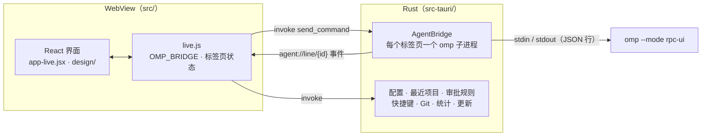

# OMP Desktop 中文版

这是 [OMP Desktop](https://github.com/apoc/omp-desktop) 的**非官方简体中文分支**。目标是保留完整功能，同时提供中文界面；它由社区维护，不代表上游作者发布。

OMP Desktop 是 [oh-my-pi](https://github.com/can1357/oh-my-pi)（简称 `omp`）的桌面客户端。每个标签页各自运行一个 `omp` 进程，界面会实时显示回复、工具调用、代码差异、子智能体、计划、终端、浏览器和用量。应用基于 Tauri 2（Rust + 系统 WebView），不内置 Electron，也不依赖网页版聊天服务。

> **当前状态：开发中，尚未正式发布。** 本仓库目前没有已验证的中文版安装包。正式发布后，请只从 [本分支的 Releases](https://github.com/roots2001/omp-desktop-zh/releases) 下载。请勿把上游英文版安装包当作中文版下载。

## 目录

- [当前状态](#当前状态)
- [功能](#功能)
- [安装与升级](#安装与升级)
- [使用](#使用)
- [开发](#开发)
- [架构](#架构)
- [汉化维护](#汉化维护)
- [许可](#许可)

## 当前状态

已完成和仍在处理的事项要分开看：

- 桌面主界面和手机远程控制页已进行大量中文化，翻译清单保存在 [`localization/zh.json`](localization/zh.json)。
- 新增了只做完整字符串匹配的中文兜底层 [`src/zh-i18n.js`](src/zh-i18n.js)，不会翻译对话正文、用户或智能体内容、工具输出和输入框。
- 中文分支暂不连接上游应用内更新源，避免中文版被自动替换成英文版；版本按钮和 `/check-updates` 会打开发行页面。
- 发布用的 GitHub Actions 目前只配置 Windows x64 安装包构建，尚未实际跑通中文版发布流程。
- 界面截图仍是上游英文旧图，因此 README 暂不展示截图，等中文版重新截图后再补充。
- 窗口标题、原生文件选择器、Windows 安装器和右键菜单、macOS 权限说明、手机后台通知已改中文；安装器品牌、应用包标识、签名、自动更新和 macOS/Linux 实机构建仍需在正式发布前逐项确认。

更具体的维护约定和发布前清单见 [`docs/zh-branch.md`](docs/zh-branch.md)。

## 功能

这一节浓缩介绍上游 OMP Desktop 的主要能力。它们反映上游设计，不代表中文分支已经在本机完成全部实机回归。

### 项目与标签页

- **一个标签页对应一个智能体。** 每个标签页独立运行 `omp`，有各自的工作目录和配置；切换标签页后，正在进行的回合仍会在后台继续。
- **项目侧栏**（`Ctrl+B`）：按项目归类打开的标签页，并显示最近打开的项目。可以拖动项目、标签页或会话调整顺序，重启后保留。
- **会话历史**（`Ctrl+H`）：搜索并恢复已经保存的会话；同一会话已经打开时，聚焦已有标签页，不重复打开。
- **自动命名。** 新标签页先使用文件夹名，第一轮对话结束后改为会话标题；手动 `/rename` 指定的名称始终优先。
- **从文件管理器打开项目。** 目前可使用 Windows Explorer 的“用 OMP Desktop 打开”，也支持命令行 `omp-desktop /path/to/project`。应用已启动时，会复用窗口新建标签页。macOS/Linux 的菜单名称和安装器仍需在发布前验证。

### 观察智能体工作

- **工具卡片**：显示 `read`、`grep`、`bash`、`eval`、`edit`、`task` 等调用，以及实时输出、语法高亮、编辑差异和文件入口。
- **审批**：在审批面板或“设置 → 审批”选择“每次都问 / 写入时询问 / 直接执行”，支持全局和单项目设置；变更审批模式会重启该标签页的智能体，但会话继续保留。
- **环境侧栏**：显示上下文窗口占用、费用、吞吐曲线、最近工具活动和会话缩略图。
- **变更卡片**：安装并登录 GitHub CLI 后，可查看当前分支的 PR、差异数量和 CI 状态，并可选择自动修复失败检查或未解决评论。
- **子智能体管理器**：汇总 `task` 调用派生出的子智能体、时间线、工具、输出和费用。

### 浏览器面板

通过工具栏地球按钮、`Ctrl+Shift+B` 或 `/browser [url]` 打开。面板显示智能体正在操作的页面，可输入地址、前进后退、刷新和调整大小。用旁边铅笔按钮标注元素或区域后，注释会连同截图随下一条消息发送。

浏览器面板需要本机安装 Chromium 系浏览器（Chrome、Chromium、Edge、Brave 等）。每个标签页使用独立、临时的浏览器配置，关闭标签页或应用后清理。安全说明和信任边界见 [`docs/architecture/browser.md`](docs/architecture/browser.md)。

### 侧栏小部件

- **小部件插件**：任何能向标准输出打印 JSON 的程序都可作为卡片，在 `widgets.json` 中注册。首次运行前需要在侧栏批准确切命令和脚本，命令或脚本变化后会再次询问。
- **omp 扩展小部件**：扩展通过 `ctx.ui.setStatus`、`ctx.ui.setWidget` 显示的内容会成为当前标签页的侧栏卡片，也接收后台标签页的更新。

示例与格式见 [`docs/widgets.md`](docs/widgets.md) 和 [`examples/widgets/`](examples/widgets/)。

### 计划模式与输入框

- 用 `Shift+Alt+P`、`/plan` 或输入框旁的按钮切换计划模式。智能体会先写计划；可以逐段评论，再把反馈发回，批准后才开始改文件。待办事项会显示在看板中（`/todo`）。
- `/` 打开命令面板；`@` 补全项目文件路径。
- 可从文件选择器或剪贴板附加图片。
- 在空输入框按 `↑` 取回提示历史，按 `Ctrl+↑` 打开搜索式历史选择器。
- 智能体工作时发送消息可以“引导”当前回合，按 `Ctrl+Enter` 或 `Ctrl+Q` 可以排队后续消息。
- 支持模型与思考等级选择、语音转文字和实时语音会话。实时语音只适用于 Codex 配置，并需要对应的登录；切换标签页或打开设置会暂停录音。

### Git 浏览器

`Ctrl+Shift+G`、工具栏 Git 按钮或编辑卡片的文件路径可以打开 Git 浏览器：查看改动文件、完整差异、暂存/丢弃、分支和提交流程图。点击提交可以浏览该提交中的文件版本。应用通过 `gix` 读取仓库，只有暂存和丢弃操作会调用 `git`。

### 终端、统计与配置

- 每个标签页都有独立的终端，可用\`Ctrl+\`、工具栏按钮或 `/terminal` 打开。隐藏终端不会停止其中的进程；关闭标签页会终止它启动的全部进程。终端拥有你的完整权限，不受智能体审批规则限制。
- “用量”面板显示最近 24 小时的请求、费用、Token 和吞吐；“历史”面板列出当前配置的已保存会话。
- 标签页可以运行在独立的 `omp` 配置下，每个配置拥有自己的登录、会话、设置和缓存。
- **设置**（工具栏齿轮、`Ctrl+,` 或 `/settings`）按外观、布局、对话、输入框、侧栏、终端、浏览器、智能体、会话、远程访问、审批和快捷键分组，支持全局搜索和逐项重置。

### 远程访问

“设置 → 远程访问”可以让同一网络或 VPN 中的手机打开桌面标签页，查看当前会话、回答提问、发送、引导和停止智能体，并支持把页面加入手机主屏幕后接收通知。该功能默认关闭，只监听选定的网卡，必须用一次性二维码配对，且可撤销每台手机。连接使用自签名证书或你提供的证书；当前上游实现只支持 macOS/Linux。详细安全模型见 [`docs/architecture/remote-access.md`](docs/architecture/remote-access.md)。

### 安全边界

- 智能体输出按 Markdown 渲染，原始 HTML 会被转义；外部链接交给系统浏览器，危险协议不会变成可点击链接。
- 发布构建使用严格 CSP，不加载远程脚本。
- 关键令牌、API Key 和认证头会从日志和智能体输出中脱敏。
- 关闭标签页或退出应用会终止对应 `omp` 及其子进程，避免遗留孤儿进程。

## 安装与升级

### 运行要求

`omp` 必须已经安装并加入 `PATH`。Windows 常见位置是 `%LOCALAPPDATA%\omp\omp.exe`。每个版本的 OMP Desktop 都需要足够新的 `omp`；版本过旧时标签页会启动失败，并提示所需版本，可运行 `omp update` 升级。

可选安装 [GitHub CLI](https://cli.github.com/)（`gh`）并运行 `gh auth login`，用于变更卡片读取当前分支的 PR 和 CI 状态。

### 下载

**中文版当前尚未发布。** 正式发布后，安装包应从这里下载：

<https://github.com/roots2001/omp-desktop-zh/releases>

发布工作流目前只计划产出 Windows x64 的 `.msi` 和 NSIS `.exe`。在正式发布记录出现前，不要使用上面的上游英文版安装包冒充中文版。

### 升级

当前策略是从中文分支的发行页面手动下载新版安装包，覆盖安装后重启应用。应用内的检查入口只负责打开发行页面，不会连接上游更新源，也不会自动安装更新。

不要从上游 Release 更新已经安装的中文版：上游安装包是英文界面，应用包信息也可能不同。是否启用中文分支自己的签名更新源，需要等独立仓库、签名密钥和更新流程都验证后再决定。

## 使用

打开项目后，在底部输入框向智能体提问。选择语言模型、思考等级、审批模式等入口都在工具栏和设置中；常用快捷键可参考下面的表格。上游的终端、Git、浏览器、远程访问等实现细节见 [架构](#架构) 和 `docs/architecture/`。

### 键盘快捷键

macOS 上以 `⌘` 代替 `Ctrl` 的常用组合键同样有效。所有快捷键都可到“设置 → 快捷键”（`Ctrl+/`）修改。

| 操作 | 默认按键 |
|---|---|
| 命令面板 | `Ctrl+K` |
| 会话历史 | `Ctrl+H` |
| 设置 / 设置 → 快捷键 | `Ctrl+,` / `Ctrl+/` |
| 显示或隐藏项目侧栏 | `Ctrl+B` |
| 显示或隐藏浏览器面板 | `Ctrl+Shift+B` |
| 新建 / 关闭标签页 | `Ctrl+T` / `Ctrl+W` |
| 显示或隐藏终端 | ``Ctrl+`` |
| Git 浏览器 | `Ctrl+Shift+G` |
| 下一个 / 上一个标签页 | `Ctrl+Tab` / `Ctrl+Shift+Tab` |
| 提示历史选择器 | `Ctrl+↑` |
| 中断当前回合 | `Esc` |
| 切换思考等级 | `Shift+Tab` |
| 切换 / 选择模型 | `Ctrl+P`（`Ctrl+Shift+P` 返回）/ `Alt+M` |
| 切换计划模式 | `Shift+Alt+P` |
| 排队一个后续消息 | `Ctrl+Enter` 或 `Ctrl+Q` |
| 打开发行页面 | 无默认按键，可在设置中绑定 |

### 斜杠命令

桌面端在内置命令之外，还会显示 `omp` 提供的斜杠命令和技能。内置命令包括 `/plan`、`/steer`、`/compact`、`/new`、`/history`、`/branch`、`/model`、`/thinking`、`/login`、`/live`、`/todo`、`/export`、`/settings`、`/shortcuts`、`/browser` 和 `/check-updates`。其余命令（例如 `/rename`、`/mcp`、`/skill:<name>`）由 `omp` 或其扩展提供。

## 开发

开发需要 Rust stable、Node.js 18+ 和 Tauri 2 所需的系统依赖。Windows 需要 WebView2；Linux 需要 WebKitGTK 4.1。详见 [Tauri 环境准备](https://tauri.app/start/prerequisites/)。

从本仓库工作目录开始：

```powershell
npm install                 # 安装 Tauri CLI
npm run dev                 # 开发模式；WebView 内用 Babel 转译 JSX
npm run build:frontend      # 生成 dist/，用作发布构建的前端
```

Rust 依赖和桌面安装包构建：

```powershell
Set-Location src-tauri
cargo test --locked
```

前端回归测试：

```powershell
npm test
node tests/test-zh-i18n.mjs
node scripts/zh/extract.mjs --stats
```

项目没有 JS 打包器。开发时 `src/index.html` 按依赖顺序加载脚本，并由 `@babel/standalone` 在页面内转译 JSX；发布构建由 `scripts/build-frontend.mjs` 预先编译到 `dist/`。更细的脚本顺序、CSP 和贡献约束见 [`AGENTS.md`](AGENTS.md)，用户可见变更记录在 [`CHANGELOG.md`](CHANGELOG.md)。

## 架构



- **Rust（`src-tauri/src/`）**：创建并监管每个标签页的 `omp`，处理进程组、后台标签页回放、审批、Git、配置、终端、浏览器、远程访问和更新等功能。
- **桥接层（`src/live.js`）**：处理 RPC、标签页注册与状态快照，向 React 暴露 `window.OMP_BRIDGE`。
- **界面（`src/app-live.jsx`、`src/app/`、`src/design/`）**：React 19，不使用 JS 打包器；纯逻辑放在 `src/app/*.js` 中，便于直接测试。

各功能的协议、状态和安全边界见 [`docs/architecture/`](docs/architecture/)。中文分支额外遵守 [`docs/zh-branch.md`](docs/zh-branch.md) 的同步与发布规则。

## 汉化维护

中文界面主要直接在 JSX 源码中翻译；动态构建的手机页面和少量运行时文案由 `src/zh-i18n.js` 做**精确匹配**兜底。不从运行时猜测翻译，也不翻译智能体或工具内容。

上游同步的推荐流程：

```powershell
node scripts/zh/extract.mjs --stats
node scripts/zh/extract.mjs --json > .tmp-zh-extract.json
# 审阅并更新 localization/zh.json
node scripts/zh/apply.mjs --dry
node scripts/zh/apply.mjs
node tests/test-zh-i18n.mjs
```

不要在未审阅时批量写入翻译。提交前检查 `--dry` 结果和 `localization/zh.json` 的差异，并确认没有改动 RPC、审批、按钮协议值等逻辑常量。完整清单见 [`docs/zh-branch.md`](docs/zh-branch.md)。

## 许可

[MIT](LICENSE)
